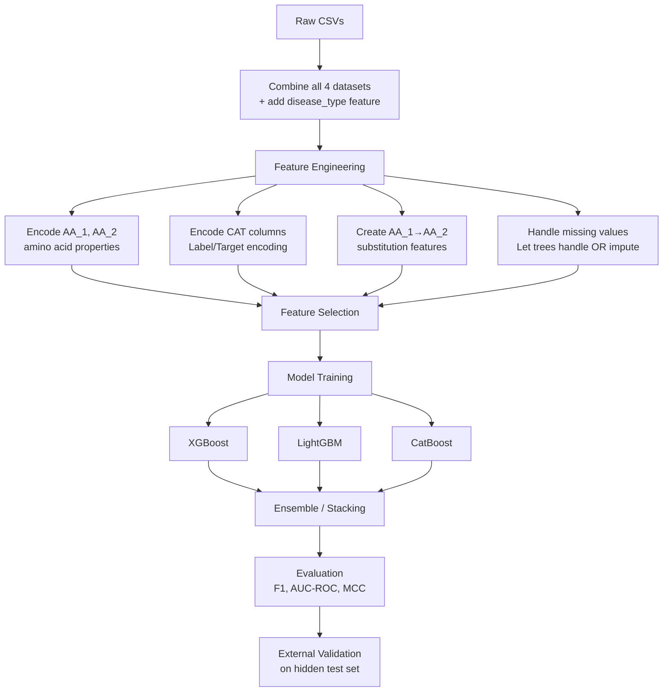

# TEKNOFEST 2026 — Genetic Variant Pathogenicity Classification

## 🎯 The Problem

You're building a **binary classifier** that predicts whether a genetic variant (a mutation/change in DNA) is:

| Label | Meaning | Description |
|-------|---------|-------------|
| **1** | **Pathogenic** | Disease-causing / harmful variant |
| **0** | **Benign** | Harmless / neutral variant |

This follows ACMG (American College of Medical Genetics) classification standards. "Pathogenic" + "Likely Pathogenic" are merged into class 1, and "Benign" + "Likely Benign" are merged into class 0.

---

## 📊 Dataset Overview

You have **4 training CSV files**, all sharing the **same 353-column schema**:

| File | Rows | Focus Area |
|------|------|------------|
| `YARISMA_TRAIN_MASTER.csv` | 2,931 | General (multi-gene) |
| `YARISMA_TRAIN_KANSER.csv` | 388 | Hereditary Cancer panel |
| `YARISMA_TRAIN_PAH.csv` | 372 | Phenylketonuria (PAH gene) |
| `YARISMA_TRAIN_CFTR.csv` | 111 | Cystic Fibrosis (CFTR gene) |
| **Total** | **3,802** | |

### Label Distribution (Class Imbalance)

| Dataset | Pathogenic (1) | Benign (0) | Ratio |
|---------|----------------|------------|-------|
| MASTER | 2,149 (73%) | 782 (27%) | ~2.7:1 |
| KANSER | 268 (69%) | 120 (31%) | ~2.2:1 |
| PAH | 310 (83%) | 62 (17%) | ~5:1 |
| CFTR | 90 (81%) | 21 (19%) | ~4.3:1 |

> [!WARNING]
> Despite the competition spec promising balanced classes (~1:1), the actual training data is **heavily imbalanced** toward Pathogenic. This is a critical factor for model design.

---

## 🧬 Feature Groups (353 Columns)

The column names are anonymized (no real feature names given), but based on the competition spec and data patterns, here's what they represent:

### 1. `Variant_ID` (Col 1) — Row Identifier
- Format: `VAR_XXXXXX` — just an ID, not a feature

### 2. `AL_1` to `AL_334` (334 columns) — Numerical Features
These are the core features, all continuous/float values. Based on the competition document, they encode:

| What They Represent | Example Sub-features |
|---------------------|---------------------|
| **Population Allele Frequencies** | How common this variant is across different ethnic populations (gnomAD exome/genome data for NFE, AFR, SAS, EAS, AMR, FIN, ASJ, MID, etc.) |
| **In Silico Prediction Scores** | Computational damage prediction scores (likely SIFT, PolyPhen-2, CADD, REVEL, MetaLR, GERP++, PhyloP, etc.) |
| **Evolutionary Conservation** | How conserved this genomic position is across species |
| **Biochemical/Structural Impact** | Physicochemical property changes from amino acid substitution (hydrophobicity, polarity, molecular weight changes) |
| **Binary Indicator Flags** | Many columns contain only 0.0 or 1.0 — likely threshold-based flags (e.g., "is this score above damaging threshold?") |

### 3. `CAT_1` to `CAT_6` (6 columns) — Categorical Features

| Column | Likely Meaning | Example Values |
|--------|----------------|----------------|
| `CAT_1` (col 28) | Population with highest allele frequency | `gnomADe_NFE`, `gnomADg_AFR`, `SAS`, `EUR`, etc. |
| `CAT_2` (col 98) | Ethnicity-related population category | `AllofUs_EUR`, `AllofUs_SAS`, `AllofUs_OTH` |
| `CAT_3` (col 102) | Genotype (reference) | `T/T`, `G/G`, `C/C`, `A/A` |
| `CAT_4` (col 103) | Genotype (alternate) | Same format as CAT_3 |
| `CAT_5` (col 194) | Another population source | Similar population labels |
| `CAT_6` (col 232) | Genotype from another database | `264690.0` (possibly sample size), genotype |

### 4. `EK_1` to `EK_9` (9 columns) — Extra Numerical Features
- `EK_1–EK_3` and `EK_4–EK_9`: Likely **aggregate pathogenicity scores** or **conservation metrics**
- Values like `5.44`, `4.95`, `4.13` suggest CADD-like phred scores or similar composite scores

### 5. `AA_1` and `AA_2` (2 columns) — Amino Acid Change
- **Single-letter amino acid codes**: `R`, `G`, `L`, `P`, `S`, `Q`, `H`, `*` (stop codon), etc.
- `AA_1` = Reference amino acid, `AA_2` = Alternate amino acid
- This is the **protein-level mutation** information (e.g., R→Q means Arginine to Glutamine)

### 6. `Label` (col 353) — Target Variable
- `0` = Benign, `1` = Pathogenic

---

## ⚠️ Key Challenges

### 1. **Massive Missing Data (~55% of features are empty per row)**
On average, **194 out of 351 features are missing per row**. This is not random — different variants have different available annotations depending on their genomic context. This is a structural missingness pattern.

### 2. **Class Imbalance**
~73% Pathogenic vs ~27% Benign in the main dataset. Even worse in PAH (83/17).

### 3. **High Dimensionality**
334+ numerical features for only ~3,800 samples → risk of overfitting.

### 4. **Mixed Feature Types**
Numerical (floats), categorical (population labels, genotypes), and character-based (amino acid codes) all need different encoding strategies.

### 5. **Feature Redundancy**
Many features come in triplets: `(score, p-value/flag, binary_threshold)`. There's likely high correlation between related features.

### 6. **Small Domain-Specific Subsets**
The CFTR set has only 111 samples. Training a single model or separate per-disease models is a strategic decision.

---

## 🤖 ML Model Recommendations

### Tier 1: Start Here (Strong Baselines)

#### 🥇 **Gradient Boosted Trees (XGBoost / LightGBM / CatBoost)**
This is the **single best choice** to start with for this problem:

- ✅ **Handles missing data natively** — XGBoost and LightGBM learn optimal split directions for missing values without imputation
- ✅ **Handles mixed feature types** — CatBoost has native categorical support
- ✅ **Robust with high dimensionality** — built-in feature selection via tree splits
- ✅ **Handles class imbalance** — `scale_pos_weight` parameter
- ✅ **Tabular data champion** — consistently wins Kaggle competitions with structured/tabular data
- ✅ **Fast training** — can iterate quickly on experiments
- ✅ **Feature importance** — gives interpretability for free

> [!TIP]
> **CatBoost** is especially interesting here because it handles categorical features (CAT_1–CAT_6) natively and has excellent built-in handling for missing values.

#### 🥈 **Random Forest**
- Good baseline, less prone to overfitting than single trees
- Handles missing data (with imputation)
- Provides feature importance
- Less powerful than gradient boosting but more forgiving with hyperparameters

---

### Tier 2: Potentially Better Performance

#### **Ensemble / Stacking**
- Combine XGBoost + LightGBM + CatBoost predictions
- Use a meta-learner (Logistic Regression or another lightweight model) on top
- This is the classic competition-winning strategy

#### **TabNet / TabTransformer (Deep Learning for Tabular)**
- Neural network architectures specifically designed for tabular data
- TabNet has built-in attention mechanisms → can learn which features matter per sample
- Good at handling the "different features available for different samples" pattern
- But needs more data and careful tuning than tree-based methods

---

### Tier 3: Worth Exploring

#### **Neural Networks with Embeddings**
- Embed amino acid codes (AA_1, AA_2) and categorical features
- Concatenate with numerical features
- Use a feed-forward network with dropout (critical with ~3.8K samples)
- Could capture non-linear amino acid substitution patterns

#### **AutoML (AutoGluon / H2O AutoML)**
- Automatically tries many model types and ensembles
- Great for quickly finding a strong baseline without manual tuning
- AutoGluon specifically excels at tabular competitions

---

### ❌ What NOT to Use

| Model | Why Not |
|-------|---------|
| **Plain Logistic Regression** | Can't handle the feature interactions and non-linearity in genomic data |
| **SVM** | Doesn't handle missing data; scales poorly with 350+ features |
| **CNN/RNN** | Designed for spatial/sequential data, not tabular variant features |
| **KNN** | Curse of dimensionality with 350+ features; sensitive to missing data |

---

## 🗺️ Suggested Approach / Pipeline Intuition

### Key Feature Engineering Ideas

1. **Amino Acid Substitution Matrix**: Encode the AA_1→AA_2 change using BLOSUM62 or Grantham distance scores — these capture the biological severity of the mutation
2. **Missing Value Count as Feature**: The *number* of missing features per row is itself informative (well-studied variants have more annotations)
3. **Population Frequency Aggregation**: Max, min, mean across all population allele frequencies
4. **Score Consensus Features**: How many in-silico tools agree the variant is damaging (count of binary flags = 1)

### Cross-Validation Strategy

> [!IMPORTANT]
> Use **Stratified K-Fold** (5 or 10 folds) to preserve the class ratio in each fold. Given the small dataset, avoid a simple train/test split — you'll waste data and get high variance estimates.

---

## 📈 Evaluation Metrics to Focus On

The competition will likely use a combination of:
- **F1-Score** (handles imbalance well)
- **AUC-ROC** (overall discriminative ability)
- **MCC (Matthews Correlation Coefficient)** — especially relevant for imbalanced binary classification in bioinformatics
- Possibly **accuracy** but it's misleading with imbalanced data

---

## 💡 TL;DR

| Aspect | Recommendation |
|--------|---------------|
| **Model** | Start with **XGBoost or CatBoost**, then ensemble |
| **Missing Data** | Let gradient boosted trees handle it natively |
| **Class Imbalance** | Use `scale_pos_weight`, SMOTE, or class weights |
| **Feature Engineering** | Amino acid properties, substitution matrices, missingness features |
| **Validation** | Stratified K-Fold cross-validation |
| **Final Model** | Stacking ensemble of XGBoost + LightGBM + CatBoost |
